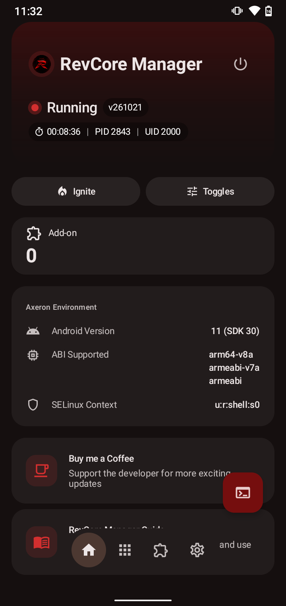
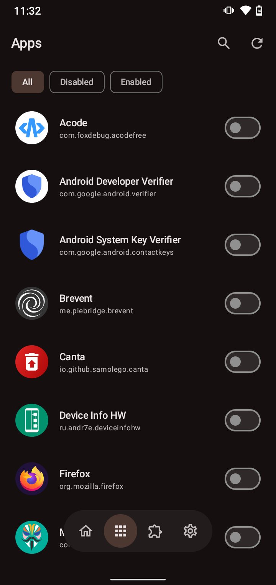
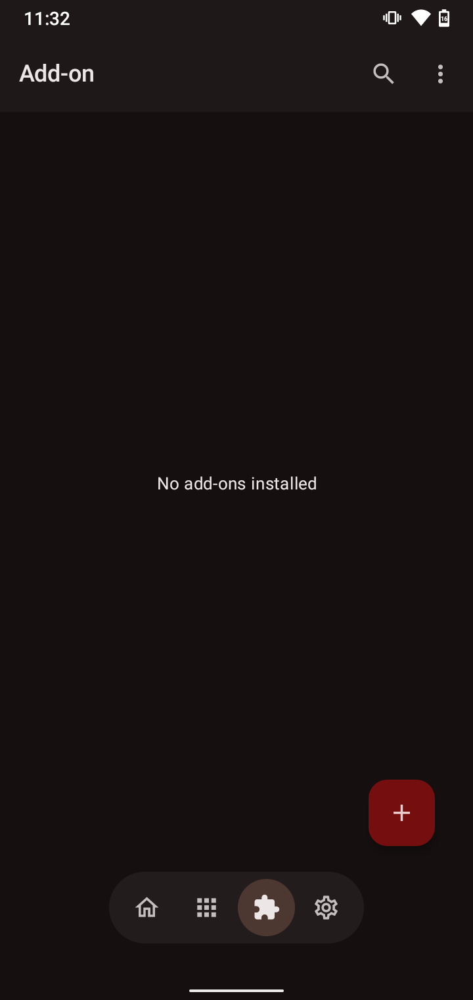
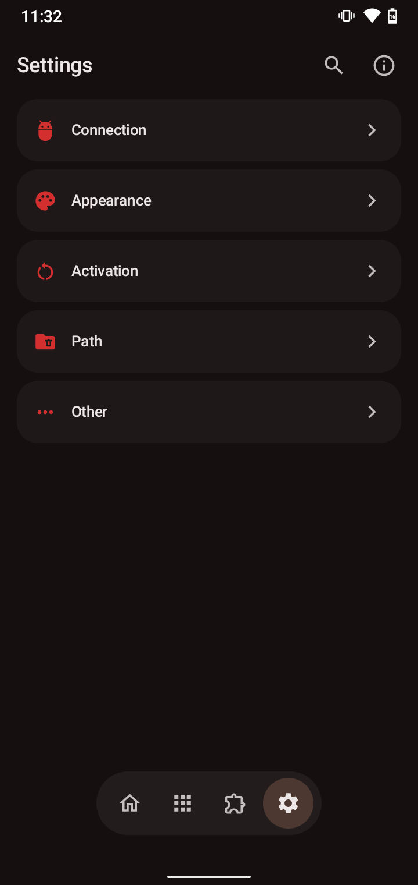
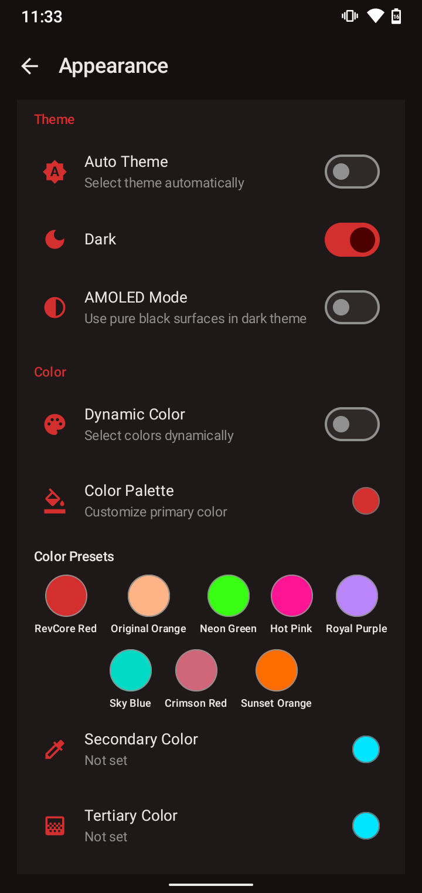
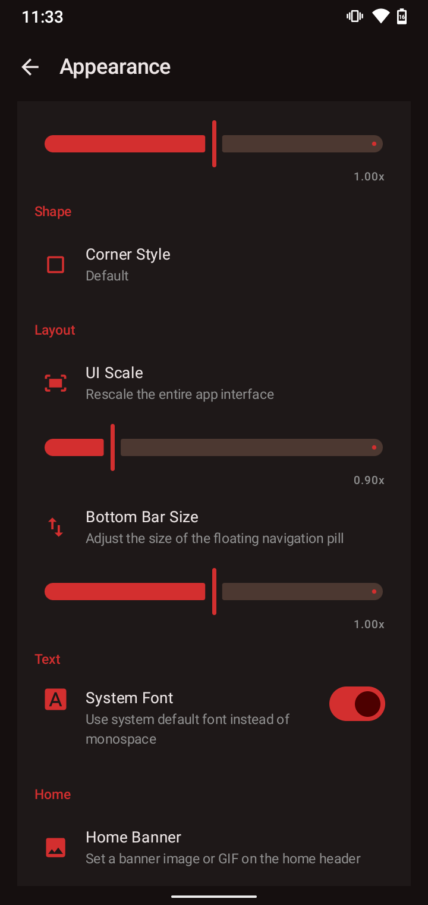
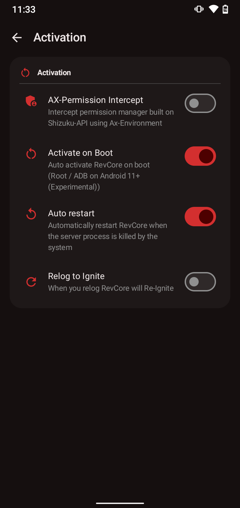
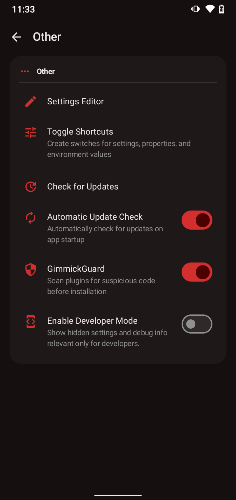
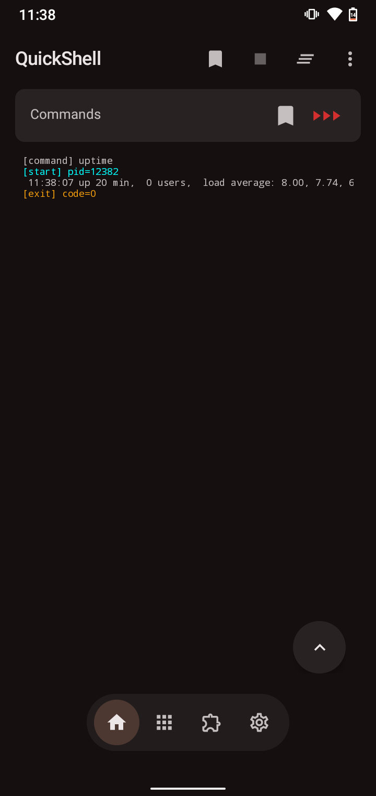
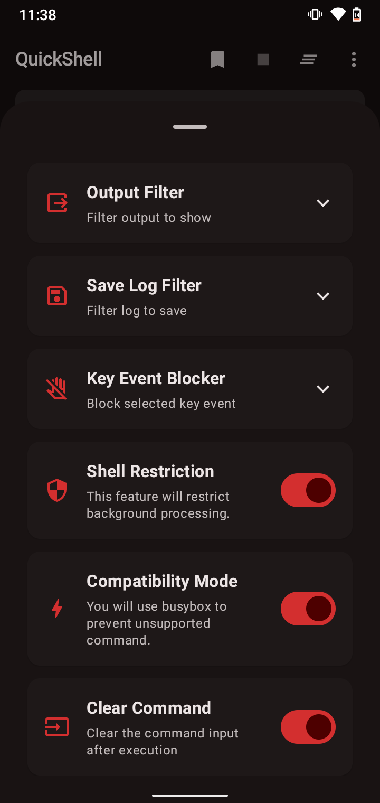

# RevCore Manager

> A privileged plugin manager for Android — ADB/wireless-debugging first, with full root support when available.

**RevCore Manager** is a RevCore-branded build of the [Axora](https://github.com/corvexis/Axora) / [AxManager](https://github.com/fahrez182/AxManager) platform, focused on reliable device control, plugin management, and a modern dark glassmorphism interface.

It is designed **ADB / Non-Root first** — root access is fully supported but never required, so it works across a wide range of devices.

## Screenshots

<table>
  <tr>
    <td align="center"><br><sub>Home Dashboard</sub></td>
    <td align="center"><br><sub>Privilege Manager</sub></td>
    <td align="center"><br><sub>Plugin Manager</sub></td>
    <td align="center"><br><sub>Settings</sub></td>
    <td align="center"><br><sub>Appearance</sub></td>
  </tr>
  <tr>
    <td align="center"><br><sub>Appearance</sub></td>
    <td align="center"><br><sub>Activation</sub></td>
    <td align="center"><br><sub>Other Settings</sub></td>
    <td align="center"><br><sub>QuickShell</sub></td>
    <td align="center"><br><sub>QuickShell Settings</sub></td>
  </tr>
</table>

## Key Features

- **Privileged Plugin Management**
  Install, enable, disable, and configure plugins with full lifecycle support — actions, ignition, and progress logs.
- **Multiple Activation Modes**
  Root shell, Wireless Debugging pairing, and PC ADB over TCP — with automatic reconnection and boot activation.
- **WebUI & JavaScript Bridges**
  Plugins can serve browser-based interfaces with bidirectional JS bridges for deep device control.
- **Built-in Shell & BusyBox**
  Terminal executor with bundled BusyBox applets for scripting and system tasks.
- **Privilege Manager**
  Per-app permission management powered by the privileged server.
- **Customizable Experience**
  Dark glassmorphism UI, multiple accent themes, quick-settings tiles, and saved shell commands.
- **Optional Root Compatibility**
  Automatically leverages root access when present, with no hard dependency on it.

## Build & Install

Clone the repository and build using Android Studio or Gradle:

```bash
git clone https://github.com/revBlackCore/RevCoreManager.git
cd RevCoreManager
./gradlew assembleDebug
```

> **Note:** the `api/` directory is a git submodule — run `git submodule update --init --recursive` after cloning.

Install the built APK to your device via ADB:

```bash
adb install manager/build/outputs/apk/debug/RevCoreManager_v*_*.apk
```

## Contribution

Contributions, issues, and suggestions are welcome! Open an issue or submit a pull request to propose improvements or report bugs.

## Credits

### Original Projects
- **[Axora](https://github.com/corvexis/Axora)** by corvexis — streamlined fork of AxManager
- **[AxManager](https://github.com/fahrez182/AxManager)** by fahrez182 — original project

RevCore Manager is derived from Axora/AxManager. Redistributions or modifications must retain attribution to the original developers.

### References & Inspirations
- **[Magisk](https://github.com/topjohnwu/Magisk)** — Inspiration for BusyBox integration and unrooted plugin concepts
- **[Shizuku](https://github.com/RikkaApps/Shizuku)** — Reference for ADB-based permission handling and Android IPC
- **[KernelSU](https://github.com/tiann/KernelSU)** — Inspiration for UI components and WebUI features

## Legal Disclaimer

This project includes adapted code from:
- AxManager (© Fahrez182), licensed under Apache License 2.0
- Axora (© corvexis), licensed under Apache License 2.0
- Shizuku Manager (© Rikka Apps), licensed under Apache License 2.0
- Other open-source projects as credited above

RevCore Manager ships its own visual identity (logo, icons, and theme) and does not distribute original visual assets from AxManager, Axora, or Shizuku Manager, nor does it claim to be an official replacement. All adapted code complies with the Apache License 2.0.

## License

Licensed under the [Apache License 2.0](LICENSE).
